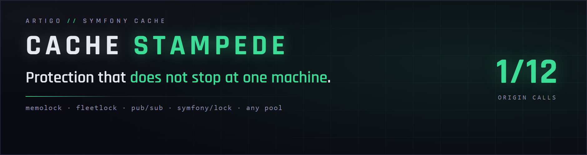
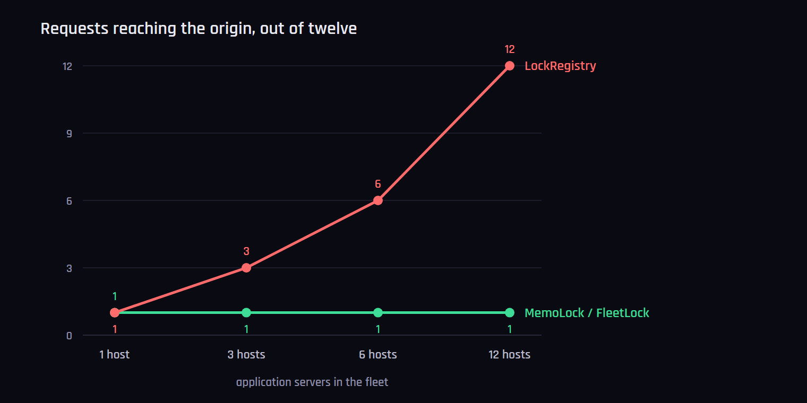
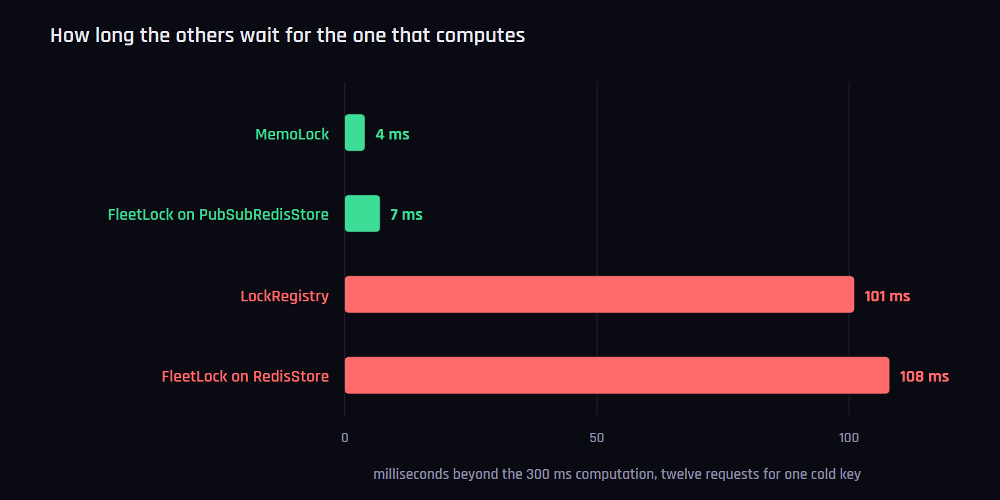
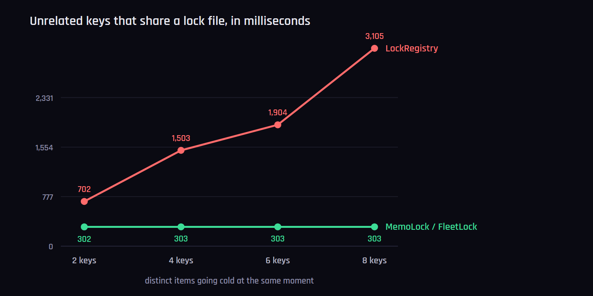

<p align="center">
	
</p>

**Stampede protection for `symfony/cache` that keeps a cold key to one origin call — on one server or on twelve.**

> **Its other half is [`artigo/versioned-cache`](https://github.com/artigo-dev/versioned-cache)**,
> a tag-aware Redis adapter whose invalidation costs four commands whether three
> items match or twenty thousand. This package keeps the herd off your origin;
> that one keeps the invalidation from being expensive in the first place.
> Neither depends on the other — see [Use them together](#use-them-together).

## What it is for

A cache key expires. The next request misses it and computes it — a report
that takes 400 ms, a query over a large table, a render. Every request that
arrives during those 400 ms misses it too, and without protection every one
of them runs the same computation. Symfony's answer is `LockRegistry`: the
first miss takes a `flock()` on a local file and computes, the others wait for
that file and then read what the first one stored. This package is about what
happens to that answer when the application runs on more than one server, and
when two keys that have nothing to do with each other land on the same lock
file.

**Example.** The key `report-monthly` expires at 12:00:00 on a fleet of twelve
application servers, and twelve requests arrive in the same moment, one per
server. The report takes the database 300 ms.

- **No protection:** twelve identical queries reach the database together,
  and each request waits 300 ms for its own.
- **`LockRegistry`:** one query per server. On one server that is one; on
  twelve servers it is twelve, because each server's lock file is its own and
  no other machine can see it. The user-facing wait is the same 300 ms; what
  scales with the fleet is the load at the origin.
- **This package, `MemoLock` or `FleetLock`:** one query across the fleet.
  The eleven requests that did not run it wait for the one that did, and are
  served what it stored: 4 ms behind it with `MemoLock`, which is woken by a
  message, 108 ms behind with `FleetLock`, whose waiters poll.

So the lock moves from a local file into a store every server shares, and a
cold key costs the origin one computation whatever the fleet size, at the
price of a few Redis commands per miss and a second connection for the
waiters' wake-up.

The second thing `LockRegistry` does is lock **a slot, not the key**: its lock
files are a fixed list — 24 on Symfony 8.1, 25 on 6.4 and 7.3 — and a key picks
one by `abs(crc32($key)) % count($files)`. Two unrelated items that land on
the same file wait for each other, for a lock that protects nothing they
share: `product-42` waits behind `report-monthly` for the whole 300 ms. The
locks here are named after the key, so that never happens. Both are measured
in [Measured, not asserted](#measured-not-asserted).

## Installation

```bash
composer require artigo/cache-stampede
```

## Usage

```php
use Artigo\Cache\MemoLock;
use Symfony\Component\Cache\Adapter\RedisAdapter;

$pool = new RedisAdapter(RedisAdapter::createConnection('redis://127.0.0.1'));
$pool->setCallbackWrapper(MemoLock::fromDsn('redis://127.0.0.1'));
```

That is the whole integration. `setCallbackWrapper()` is a **public** method on
every Symfony adapter — no subclassing, no fork, no patched core — so this works
with any pool: Redis, filesystem, chained, tag-aware, your own.

[`examples/expensive-query.php`](examples/expensive-query.php) runs it — eight
processes released together on a key that has just expired:

```console
$ php examples/expensive-query.php
eight requests on a cold key, 400 ms to answer it

  waited   after   405 ms  ->  the report
  waited   after   405 ms  ->  the report
  waited   after   406 ms  ->  the report
  queried  after   404 ms  ->  the report
  ... four more

the query ran 1 time(s) for 8 requests
```

One query, eight answers, and the seven that waited are served **2 ms behind**
the one that ran it.

The package holds three things: two **locks** for a cache pool's callback,
`MemoLock` and `FleetLock`, which differ in what the lock is made of; a
**decorator**, `StaleCache`, which serves a value past its lifetime while one
process refreshes it; and, for `MemoLock` only, two calls for work that is not
a cache item, `once()` and `exclusively()`.

## MemoLock: one request through, woken by a message

**The setup.** `MemoLock` keeps the lock in Redis, named after the key. The
first miss takes it with `SET NX PX` and computes; when it has saved the value
it releases the lock with `DELEX … IFEQ` and sends one `PUBLISH` on a channel
named after the key. Every other miss finds the lock taken, subscribes to that
channel, and reads the pool when the message arrives.

**The question.** How does a waiter find out that the holder is done?

**Example.** The holder finishes computing `report-monthly` at 12:00:00.300.
A waiter that looks at the lock every 100 ms notices at 12:00:00.400 at the
latest, and on average 50 ms late. A waiter blocked on the channel is woken by
the holder's message at 12:00:00.301.

- **`LockRegistry`:** waiters retry `flock(LOCK_SH | LOCK_NB)` every 100 ms.
  Measured: 101 ms over the 300 ms origin call.
- **`FleetLock` on Symfony's `RedisStore`:** waiters retry the store every
  100 ms, as the Lock component does for every store that cannot block.
  Measured: 108 ms over the same call.
- **`MemoLock`:** waiters are woken by the message. Measured: 4 ms over the
  same call, and 2 ms behind the holder in the example above.

So the message buys the waiters about a hundred milliseconds per cold key,
and costs a second Redis connection: a connection in subscribe mode cannot
serve anything else, so the subscriber cannot be the one holding the lock.
`fromDsn()` opens both for you; hand the constructor no subscriber factory and
it degrades to polling the lock key every 25 ms (`pollIntervalMs`) — still one
origin call, just a slower wake-up.

**How it works.** The lock is four plain commands and no script on Redis 8.4
and Valkey 9: `SET NX PX` takes it, `SET … IFEQ` extends it while it is still
ours, `DELEX … IFEQ` (Valkey: `DELIFEQ`) releases it on the same condition,
and `PUBLISH` wakes the waiters. A server without the two conditional forms —
Redis before 8.4, Valkey before 9 — gets a compare-and-set script for each, the
same round trip as one `EVAL`. The lock learns which dialect a connection
speaks from the server's refusals and remembers them for the connection, so
each native form is refused at most once per connection: one refused `SET`
for the extension, and for the release a refused `DELEX` and, where the server
has no `DELIFEQ` either, a refused `DELIFEQ`. The lock and its channel share a
cluster hash tag, so a cluster keeps the pair on one node.

A waiter looks at the lock's `PTTL` before every `SUBSCRIBE` and listens 100 ms
at a time: a lock that is already gone is not waited for at all, a lock about
to expire is waited for about that long, and a wake-up that went out in the
window before the subscription began — the holder was quick — costs one slice
rather than the whole `waitTimeoutMs`. After the wait the waiter reads the
item; a hit is served, and a miss — the holder died, or what it wrote expired
at once — makes it race for the lock again.

**Settings.** `lockTtlMs` (30 000) is how long the lock may be held before it
expires on its own; `waitTimeoutMs` (5 000) is how long a waiter waits before
it looks at the pool again; `pollIntervalMs` (25) is the poll without a
subscriber.

```php
new MemoLock($redis, lockTtlMs: 30_000, waitTimeoutMs: 5_000);
```

**Choosing the lock TTL:** set it to the longest the work should take. Too low
and the waiters see it expire and rebuild in parallel, which is the thing being
prevented; too high and a holder that dies keeps everybody waiting before one
of them retakes it.

## FleetLock: the same lock on any `symfony/lock` store

**The setup.** `FleetLock` takes a `symfony/lock` `LockFactory` and knows
nothing else. It has no Redis dependency of its own — no Redis class appears in
the file — so it locks on whatever store you already run: Redis, PostgreSQL,
Doctrine DBAL, Memcached, Zookeeper, anything the Lock component supports.

**The question.** What does the Lock component give up against a lock that
speaks Redis directly?

**Example.** The same twelve requests on `report-monthly`, the lock on
Symfony's `RedisStore`. One acquires and computes. The eleven others call
`acquireRead(true)`: the Lock component has no way for a store to announce
that a lock was released, so, with the exception of Flock, Semaphore and the
two PostgreSQL stores, a waiter finds out by retrying on a **100 ms sleep**.
They are served 108 ms behind the holder, where `MemoLock`'s are served 4 ms
behind.

- **`FleetLock`:** one lock abstraction across the application, any store,
  one connection — and the component's wake-up, a 100 ms poll on most stores.
- **`FleetLock` on PostgreSQL:** the store blocks natively, so the poll does
  not apply: fleet-wide *and* woken immediately, without Redis anywhere.
- **`FleetLock` on [`PubSubRedisStore`](#pubsubredisstore-the-wake-up-on-the-lock-components-side):**
  the component's own waiters are woken by a message, 7 ms behind the holder.
- **`MemoLock`:** 4 ms, Redis only, a second connection.

So `FleetLock` is the lock for a fleet with no Redis, or with one lock story
for the whole application; what it gives up is only the wake-up latency, and
only on the stores that cannot block.

```php
use Artigo\Cache\FleetLock;
use Symfony\Component\Lock\LockFactory;
use Symfony\Component\Lock\Store\RedisStore;

$pool->setCallbackWrapper(new FleetLock(new LockFactory(new RedisStore($redis))));
```

**How it works.** A miss creates the lock `cache.stampede.<key>` and tries to
acquire it without blocking. The winner computes, saves and releases. A loser
takes a *read* lock in blocking mode, so that the waiters wake together, as
`LockRegistry` does with `flock(LOCK_SH)`. The exclusive lock would hand it to
them one at a time, which measured costs little: twelve waiters on it were
served 12 ms behind a 300 ms origin call on `PubSubRedisStore`, against 7 ms
on the read lock, and 106 ms against 108 ms on `RedisStore`, where the 100 ms
poll decides. A store that cannot do shared locks falls back to the exclusive
one, which is still correct. After ten attempts at a lock that is never let go, the caller
is served rather than kept waiting: the value is computed unprotected, and a
warning says so.

**Settings.** `ttl` (30.0 s) is how long the lock may be held; the `prefix`
(`cache.stampede.`) names the locks.

```php
new FleetLock($locks, ttl: 30.0);
```

## Which one to use

Both fix the same two things: the lock is visible to the whole fleet, and it is
named after the key rather than drawn from a fixed pool of files. On the
headline benchmark they are identical — **1 origin call out of 12, across 12
machines**. Neither is a cut-down version of the other. They differ in one
decision, and everything else follows from it: **what the lock is made of.**

| | `MemoLock` | `FleetLock` |
|---|---|---|
| lock lives in | Redis, four plain commands | any `symfony/lock` store |
| a waiter is woken by | a Pub/Sub message | a 100 ms poll\* |
| overhead over a 300 ms origin call | **4 ms** | 108 ms |
| origin calls, 12 requests / 12 servers | **1** | **1** |
| connections | two, the second subscribing† | one |
| needs | `ext-redis` or Relay; Redis 7.2+ or Valkey 8+, plain commands on Redis 8.4 / Valkey 9 | `symfony/lock` |
| outside a cache pool | `exclusively()`, `once()`, `KeepAlive` | — |

\* except on the PostgreSQL stores, which block natively — fleet-wide *and*
woken immediately, without Redis anywhere.
† the subscriber is optional; without it `MemoLock` polls the lock key. Still
one origin call, just a slower wake-up.

**The 4 ms / 108 ms is not a backend difference.** Both numbers come from the
same run against the same Redis: the benchmark wires `FleetLock` as
`new FleetLock(new LockFactory(new RedisStore($redis)))`. What separates them is
only how the waiter finds out, message versus poll.

**Reach for `MemoLock` when** Redis is already in the stack, the wait a waiter
inherits is worth 100 ms to you, and a second connection is not a problem. It
is also the only one of the two that locks things that are **not cache items**
— a thumbnail, an import, a provisioned resource — through `exclusively()` and
`once()`, with a `KeepAlive` for work that outlives its own lock TTL.

**Reach for `FleetLock` when** any of these hold:

- there is no Redis, and the fleet-wide store is PostgreSQL, Doctrine DBAL,
  Memcached, Zookeeper — anything the Lock component supports;
- there *is* Redis, but you would rather have one lock abstraction across the
  application than a second, Redis-shaped one;
- you cannot spare the second connection a blocking `SUBSCRIBE` needs;
- the store is PostgreSQL, in which case the poll does not apply at all;
- the store is `PubSubRedisStore`, in which case the poll does not apply
  either: the component's own waiters are woken by the message, and the Lock
  component keeps the whole lock story.

Running `FleetLock` on Redis is an ordinary choice, not a fallback — it is what
the benchmark measures. The only thing you give up is the wake-up latency.

## PubSubRedisStore: the wake-up on the Lock component's side

**The setup.** The gap between the two locks can be closed on the Lock side.
`PubSubRedisStore` is Symfony's `RedisStore` with the two blocking interfaces
the component offers, `BlockingStoreInterface` and
`BlockingSharedLockStoreInterface`. Its waiters block on a Pub/Sub channel
named after the key until the holder's `delete()` publishes on it, then try
again; the wait is bounded by the holder's `PTTL`, so a holder that died is not
waited for beyond its lock. Everything else — the tokens, the read locks, the
refresh, the Lua that guards them — is `RedisStore`'s own.

**The question.** Does the Lock component need a lock of its own in the Cache
component to get the wake-up, or only a store that can announce a release?

**Example.** The same twelve requests on a 300 ms resolver, one host
(`stampede.php modes=fleetlock-pubsub`), in the same runs as
[the headline table](#one-cold-key-twelve-concurrent-requests):

| | origin calls | overhead over the resolver |
|---|---|---|
| `MemoLock` | 1 / 12 | 4 ms |
| `FleetLock` on `RedisStore` | 1 / 12 | 108 ms |
| `FleetLock` on `PubSubRedisStore` | 1 / 12 | **7 ms** |

Woken by a message, the Lock component's waiters were served 3 ms behind the
holder — 2 ms more than `MemoLock`'s own, a hundred less than the poll, with no
Redis command of their own in the cache.

So `FleetLock` on this store inherits the wake-up with no Redis code of its
own. The wake-up can therefore live in either place: in `MemoLock`, at 4 ms,
or inside `symfony/lock`, at 7 ms, where every Lock user would get it.

**How it works.** Like `MemoLock`, it needs a second connection for the
blocking `SUBSCRIBE`; `PubSubRedisStore::fromDsn()` opens both. A blocking
acquire tries, waits for the holder's word a slice of 100 ms at a time, never
longer than the holder's lock can live, and tries again; past `waitTimeoutMs`
(30 000) it throws `LockConflictedException`, as the component's own stores
do. `initialTtl` (300.0 s) is the locks' expiration delay, as `RedisStore`
takes it.

## `once()`: without a cache pool at all

**The setup.** The same lock, for the thing a cache is not: a thumbnail, a
generated file, a provisioned resource. One caller produces it; the rest wait
for **the thing** rather than for the lock, and carry on the moment it exists.

**The question.** When four requests ask for a thumbnail that does not exist
yet, how many render it, and what do the others wait for?

**Example.** Four requests for one thumbnail, 400 ms to render
([`examples/thumbnail.php`](examples/thumbnail.php), four processes released
on a barrier):

```console
$ php examples/thumbnail.php
four requests for one thumbnail, 400 ms to render

  rendered after   402 ms  ->  artigo-thumbnail-example.txt
  waited   after   402 ms  ->  artigo-thumbnail-example.txt
  waited   after   402 ms  ->  artigo-thumbnail-example.txt
  waited   after   402 ms  ->  artigo-thumbnail-example.txt
```

- **A mutex** (`symfony/lock`, or `exclusively()` below): hands the lock to
  each of the four in turn, and each decides, again, whether to render.
- **`once()`:** one render, four answers, and the three waiters finish
  **within a millisecond** of the one that did the work — that is the message
  arriving, not a poll coming round.

So `once()` is for waiters that want the result: they are woken by a message,
look for the thing, and never take the lock themselves while it is there.

```php
$thumbnail = $lock->once(
    'thumbnail:'.$id,
    exists: static fn (): ?string => is_file($out) ? $out : null,
    make: function () use ($source, $out): string {
        $this->render($source, $out);

        return $out;
    },
);
```

**How it works.** `exists` is asked **before** any lock is taken, so a caller
arriving after the work is done never touches Redis for one. Returning `null`
means "not there yet". A waiter asks `exists` again after every wake-up; when
the holder died or produced nothing, it races for the lock, ten attempts at
most, and then produces the thing itself. `make` is handed a
[`KeepAlive`](#keepalive-work-that-outlasts-the-lock). A lock that cannot be
reached does not stop the work: the thing is produced unprotected and a
warning says so.

## `exclusively()`: a plain critical section

**The setup.** When the waiters want the lock rather than a result.

```php
$lock->exclusively('import:companies', function (): void {
    $this->importCompanies();
});
```

**The question.** Why have this beside
[`symfony/lock`](https://symfony.com/doc/current/lock.html), which is the
better mutex — it refreshes a held lock, releases on destruct and speaks to a
dozen stores?

**Example.** Eight workers holding a 200 ms section in turn, fully serialised
either way:

| | total | handover cost over eight |
|---|---|---|
| `symfony/lock` | 1 705 ms | 105 ms |
| **`exclusively()`** | **1 610 ms** | **10 ms** |

Eight processes released on one barrier, `symfony/lock` 8.1.11 on `RedisStore`
against `exclusively()`, the middle of three runs; the harness is a script
outside this repository, which has no benchmark for it yet.

- **`symfony/lock`:** each handover costs the next worker's poll, about 15 ms
  here, 105 ms over eight.
- **`exclusively()`:** each handover is a message, 10 ms over eight.

So the wake-up pays here too, which is the reason this is worth having beside
`symfony/lock`; what `symfony/lock` still does better is below.

**Unlike everything else here, this throws.** A cache that cannot take a lock
computes anyway, because a duplicated computation beats a failed request; a
caller who asked that two workers never run something at once would rather hear
that it did not run, so an unreachable lock, or one still held after ten
attempts, is a `LockUnavailable`.

**What `symfony/lock` still does better:** it **releases on destruct**, so a
process that `exit()`s or fatals mid-section hands the lock back at shutdown,
where a `finally` does not run at all. What that case costs here is the lock's
remaining TTL, which is also the longest a waiter will wait for it — and a
destructor is itself best effort, skipped on a hard crash.

## KeepAlive: work that outlasts the lock

**The setup.** A lock has a TTL so that a holder that dies does not keep
everybody waiting forever. An import that takes longer than the TTL would have
its lock run out underneath it, and the next worker would start the same
import beside it.

**The question.** How does a long piece of work keep its lock without
guessing the TTL up front?

**Example.** The closure holding the lock is handed a `KeepAlive`. Call it as
the work goes and the expiry moves out by a full TTL each time:

```php
$lock->exclusively('import:companies', function (KeepAlive $keepAlive) use ($rows): void {
    foreach ($rows as $row) {
        $this->import($row);
        $keepAlive();
    }
});
```

- **A TTL long enough for the worst case:** a holder that dies keeps the
  waiters waiting for that whole TTL.
- **A `KeepAlive` per row:** the lock is extended only while the work goes on,
  and a holder that dies is waited for one TTL at most.

So the TTL can be short, and the work says as it goes that it is still alive.

**How it works.** `once()` hands one to its `make` for the same reason.
Closures that do not want it simply declare no parameter. It **throws**
`LockUnavailable` if the lock has gone — expired, and taken by somebody else
while the work ran. That is the one thing a long section needs to hear, and a
return value is too easy not to read; `symfony/lock`'s `refresh()` throws for
the same reason. The extension is a single `SET … IFEQ` (Redis 8.4, Valkey
8.1), or a compare-and-set script where the server has no such option: either
way it rewrites the lock only while it still carries our token, so nobody
else's lock is ever touched. It takes an optional number of milliseconds for
the extension; the lock's own TTL is the default.

## Per-call overrides

**The setup.** A slow resolver wants a lock that outlasts it; a cheap key is
not worth locking at all. Symfony's `get()` has nowhere to say either — its
signature is `($key, $callback, $beta, &$metadata)` and `$beta` governs
probabilistic early expiry, not locking.

**The question.** How does one call borrow a different lock, or none, and
give the pool's own back afterwards?

**Example.** `setCallbackWrapper()` hands back whatever it replaced, so a
single call can borrow a different lock and give it back:

```php
// a longer lock, for this call only
$value = $lock->with(lockTtlMs: 30_000)->around(
    $pool,
    static fn () => $pool->get('external-api', $resolver),
);

// no lock at all, for a key not worth protecting
$value = MemoLock::unguarded($pool, static fn () => $pool->get('cheap', $resolver));
```

- **Written by hand:** swap the wrapper, call, swap it back — and the swapping
  back is the part that gets forgotten when the call throws.
- **`with()` and `around()`:** `with()` answers a copy, so the lock the pool
  normally uses is untouched, and the restoring happens in a `finally`.

So a per-call setting lives in the call, and the pool's lock is never left
changed.

## StaleCache: serving stale while it refreshes

**The setup.** A lock keeps a hot key from being computed twelve times when it
expires; the other eleven requests still wait for the one computation.
`StaleCache` keeps them from waiting at all: for a grace period past its
lifetime, a value is served at once while one process refreshes it.

**The question.** When a popular value's lifetime ends, does anyone have to
wait for it to be computed again?

**Example.** Twelve requests arrive at a hot key as its lifetime ends, and the
origin takes 300 ms (`stampede.php modes=swr`, `MemoLock` on every row):

| Setup | Origin calls | Requests that waited for one | Wait p50 | Wait max |
|---|---|---:|---:|---:|
| `expiring` | 1 | 12 / 12 | 303 ms | 304 ms |
| `beta` | 1 | 8 / 12 | 302 ms | 303 ms |
| **`swr`** | 1 | **0 / 12** | **1 ms** | **1 ms** |

- **`expiring`**, the key going cold at the barrier: one computes, eleven wait
  for it.
- **`beta`**, Symfony's probabilistic early expiration, with the twelve
  arriving in a burst 100 ms before the expiry, which is its worst case: with
  β = 1 and a 300 ms computation each draws an early recomputation about 72 %
  of the time (8 to 10 of 12 over six runs), and all of those wait behind
  the lock for the one that runs. Requests spread over the last seconds would
  mostly find the value already recomputed.
- **`swr`**, `StaleCache`: every request is served at once and the refresh
  runs after the response; the origin call is the refresh.

So the stale value is served for up to `staleSeconds` after its lifetime,
and in exchange nobody waits for the refresh. Redis 8.10.1, PHP 8.5.12, this
package 2.0.0 over symfony/cache 8.1.11, the benchmark in a container on the
Redis container's network; the middle of three runs per column, and
8.2.0-BETA1 within 1 ms (beta 9 of 12).

```bash
php benchmarks/stampede.php modes=swr
```

```php
use Artigo\Cache\MemoLock;
use Artigo\Cache\Stale\RefreshQueue;
use Artigo\Cache\StaleCache;
use Symfony\Component\Cache\Adapter\RedisAdapter;
use Symfony\Contracts\Cache\ItemInterface;

$lock = MemoLock::fromDsn('redis://127.0.0.1');
$inner = new RedisAdapter(RedisAdapter::createConnection('redis://127.0.0.1'));
$inner->setCallbackWrapper($lock);

$pool = new StaleCache($inner, staleSeconds: 60, staleIfErrorSeconds: 600, election: $lock);
$pool->setDeferrer($queue = new RefreshQueue());
$queue->flushAtShutdown();

$article = $pool->get('article-42', function (ItemInterface $item): Article {
    $item->expiresAfter(300);   // fresh for five minutes, served stale for one more

    return $this->load(42);
});
```

**What is stored.** A `Record`: the value and its three times — fresh until
the lifetime the callback set, servable while refreshed for `staleSeconds`
more, kept for `staleIfErrorSeconds` after that. The times travel inside the
value, so any marshaller carries them, `DeflateMarshaller` included, and the
inner pool keeps the Record for all three. A stale read is served with
`StaleCache::METADATA_STALE` in `$metadata`.

**What stays hard.** An invalidated value is never served stale: a tag
invalidation, a delete or a clear makes the inner pool answer a miss, and the
miss is computed. A forced `get()` (`$beta = INF`) recomputes over a fresh
value. A value whose callback sets no lifetime never turns stale; give the
decorator a `defaultLifetime`, not the inner pool.

**The inner pool is storage.** What it holds is Records: read and write
through the decorator. Its PSR-6 side is strict — `getItem()` on a stale value
is a miss — and `save()` stores with the decorator's times.

**On versioned-cache.** A refresh is the inner pool's forced `get()`, which
[`artigo/versioned-cache`](https://github.com/artigo-dev/versioned-cache)
guards like a miss: a delete that lands while the refresh computes refuses its
write, and a tag invalidation leaves it stale.

### Election: who refreshes

**The setup.** A stale read is served at once and asks an `Election` for the
refresh — without waiting. Whoever does not win serves the stale value and
moves on.

**The question.** When twelve servers read a stale value in the same second,
how many refresh it?

**Example.** `MemoLock` and `FleetLock` both implement `Election`: a lock of
their own, taken without blocking (`SET NX`, or a `symfony/lock` acquired
without waiting), so one process across the fleet refreshes and the other
eleven serve the stale value. `FlockElection`, the default when no election
is given, is a local `flock()`: one process per server refreshes, so twelve
servers refresh twelve times — still without a stampede, since each serves
the stale value meanwhile.

- **`FlockElection`:** no store to run, a scope of one machine, and no TTL: a
  refresh that hangs holds its lock file — one of 64 the keys share — until
  the process ends, which in a long-running worker may be never.
- **`MemoLock` or `FleetLock`:** one refresh across the fleet, and a lock that
  expires (`refreshLockTtlMs`, 30 000). Give a worker one of these.

So the election bounds the refreshes to one per server, or one per fleet, and
never makes a request wait for it.

**How it works.** The winner looks again — another process may have refreshed
it meanwhile — and then recomputes through the inner pool's forced `get()`, so
through its lock wrapper too. A refresh that throws keeps the stale value, and
logs it; so does an election that cannot be reached.

### RefreshQueue and the deferrer: when the refresh runs

**The setup.** Without a deferrer the refresh runs inline, and the request
that found the value stale gets the new one — and waits for it. With a
`RefreshQueue` as the deferrer it runs after the response, once per key.

**The question.** When does the refresh run, and who waits for it?

**Example.** A page reads 25 stale fragments. Inline, the page waits for 25
refreshes before it is sent. Queued, the page is sent with the 25 stale
fragments, and the 25 refreshes run once the response is out; a second stale
read of the same fragment during the page queues nothing, since one refresh
is already queued for that key.

- **Inline** (no deferrer): correct, and the request that happens upon a
  stale value pays for the refresh.
- **`RefreshQueue`:** the request pays nothing; the refresh runs on
  `kernel.terminate` or `console.terminate` in a Symfony application, through
  the shipped `TerminateSubscriber`, and between the messages a Messenger
  worker handles through the `kernel.reset` tag — the worker is one command,
  so its `console.terminate` comes only when it stops.

So the deferrer moves the refresh out of the response, and the queue holds
one refresh per key.

```yaml
services:
    Artigo\Cache\Stale\RefreshQueue:
        tags: [{ name: kernel.reset, method: reset }]
    Artigo\Cache\Stale\TerminateSubscriber:
        arguments: ['@Artigo\Cache\Stale\RefreshQueue']
        tags: [kernel.event_subscriber]
    app.cache.articles:
        class: Artigo\Cache\StaleCache
        arguments: ['@cache.app', 60, 600]
        calls: [[setDeferrer, ['@Artigo\Cache\Stale\RefreshQueue']]]
```

**How it works.**

- `messenger:consume` resets the tagged services after every message it
  handles, on Symfony 6.4 to 8.x, unless it runs with `--no-reset` (from 8.1,
  `--no-reset=N` resets every N messages); without a reset the queue waits
  for the worker to stop. A refresh that fails during a reset is logged rather
  than thrown, since a reset that throws stops the worker. A refresh that
  fails during a `flush()` keeps the others from nothing: they all run, and
  the first failure is thrown once they have.
- A queue holds 1,000 refreshes at most; `new RefreshQueue(maxRefreshes: 5000)`
  sets another limit. Past it a stale read is served without a refresh
  queued: the first read turned away logs a warning (give the queue a logger
  with `setLogger()`), and a read after the next flush queues the refresh
  again.
- Without a kernel, `flushAtShutdown()` runs it when the script ends; under
  PHP-FPM call `fastcgi_finish_request()` first, or the client waits for it.
- Any callable can be the deferrer. It is called with the refresh, a
  `\Closure` that takes no argument, and a key that is the same for every
  refresh of one cache key in this pool and differs for any other key or
  pool, so a deferrer can hold one refresh per key as `RefreshQueue` does.
  The key is passed only when the parameter that would receive it takes a
  string: a second parameter, or a variadic one, that is untyped or typed
  `string`, `?string`, `mixed` or a union holding one of them. Any other
  deferrer — one of a single parameter, or one whose second parameter is an
  `int` or a `\Closure ...$refreshes` — is called with the refresh alone.

### Stale-if-error

**The setup.** Past its stale time a value is computed like a miss, by the
request that reads it.

**The question.** What is served when that computation fails — the database
is down, the API times out?

**Example.** `article-42` was fresh for five minutes and servable for one
more; `staleIfErrorSeconds` is 600. Seven minutes after it was written a
request reads it and the origin throws.

- **`staleIfErrorSeconds: 0`:** the exception reaches the caller.
- **`staleIfErrorSeconds: 600`:** the old article is served, the failure
  logged, and the next read tries again; after the 600 seconds the exception
  reaches the caller.

So a value is kept for `staleIfErrorSeconds` after its stale time, to be
served only when computing it again fails.

## Soft serving: after a tag invalidation, too

**The setup.** A tag invalidation makes a value a miss, not a stale value: the
inner pool answers a miss. With `soft: true`, and an inner pool that keeps
what a soft invalidation reached —
[`artigo/versioned-cache`](https://github.com/artigo-dev/versioned-cache)
with `softGraceSeconds` — a value this pool wrote is served stale after its tag
falls as well, counted from the invalidation, and refreshed once.

**The question.** When a tag that 300 fragments carry falls, must every
visitor wait for the fragments to be recomputed?

**Example.** 300 fragments under one tag, twelve visitors reading 25 each, and
a 20 ms origin (versioned-cache's `benchmarks/soft.php`):

- **A hard invalidation:** 12 of 12 visitors wait for the origin, about
  560 ms each, and the 300 recomputations run during the responses.
- **A soft invalidation:** 0 of 12 wait; every visitor is served the old
  fragments at once, and the 300 recomputations run after the responses, one
  per fragment, elected through `MemoLock`.

So a soft invalidation trades serving the old value for up to the grace
against making visitors wait for the recomputation; what must never be served
again is invalidated hard.

```php
$inner = new VersionedRedisTagAwareAdapter($redis, softGraceSeconds: 600);
$inner->setCallbackWrapper($lock);   // before it is handed over

$pool = new StaleCache($inner, staleSeconds: 60, election: $lock, soft: true);

$pool->invalidateTags(['menu']);               // served stale, refreshed once
$pool->invalidateTags(['price-42'], hard: true); // a miss, as ever
```

**How it works.** The opt-in is the pool's: a value written by a pool without
`soft` is a miss after an invalidation whatever kind it was. A hard
invalidation, a delete and a clear stay hard. The pool puts its own callback
wrapper in front of the inner pool's, which a miss still goes through, so set
the inner pool's lock first. The wrapper asks the inner pool for the value
the invalidation reached and kept, through versioned-cache's
`AgedItemsInterface`; a value written soft and invalidated less than its stale
and error times ago comes back as it is, its lifetime ended at the
invalidation, and is served stale and refreshed. A soft `StaleCache` refuses
an inner pool that does not implement that interface or takes no callback
wrapper.

## Measured, not asserted

`benchmarks/stampede.php` spawns real processes, releases them on a shared
wall-clock barrier, and counts how many reach the origin. Measured on
2026-11-06 inside Docker Desktop (WSL2, Windows 11, 24 CPUs), the benchmark in
a `php:8.5-cli` container (PHP 8.5.12, phpredis 6.3.0) on the network of a
Redis 8.10.1 container, this package 2.0.0 against symfony/cache and
symfony/lock 8.1.11; every number is the middle of three runs (seven for two
colliding keys), and 8.2.0-BETA1 is within 2 ms of each.

### One cold key, twelve concurrent requests

| Setup | Origin calls | Overhead |
|---|---|---|
| no protection | 12 / 12 | 3 ms |
| `LockRegistry`, 1 app server | 1 / 12 | 101 ms |
| `LockRegistry`, 3 app servers | 3 / 12 | 101 ms |
| `LockRegistry`, 6 app servers | 6 / 12 | 101 ms |
| `LockRegistry`, 12 app servers | **12 / 12** | 1 ms |
| **`FleetLock`**, any fleet size | **1 / 12** | 108 ms |
| **`MemoLock`**, any fleet size | **1 / 12** | **4 ms** |

```bash
docker compose up -d
php benchmarks/stampede.php workers=12 resolverMs=300 hosts=12
```



`LockRegistry` gives **exactly one origin call per app server** — three hosts,
three calls; twelve hosts, twelve. Its lock files are local, so a second machine
cannot see them. Note the last row of its own block: twelve hosts looks *fast*
only because nobody is waiting for anybody.

How long the others wait for the one that computes, with the Lock component's
waiters woken by a message too ([`FleetLock` on `PubSubRedisStore`](#pubsubredisstore-the-wake-up-on-the-lock-components-side)):



### Different keys that happen to share a lock file

`LockRegistry` never locks the key. It locks one of a **fixed list of files** —
Symfony's own `Adapter/*.php` sources, opened for nothing but `flock` — picked
by `abs(crc32($key)) % count($files)`. The list is a constant, and its docblock
says what its length means: *"The number of items in this list controls the max
number of concurrent processes."* So one machine can compute **24 distinct keys
at once** on Symfony 8.1, and the 25th waits for work it has nothing to do with.

Distinct cold keys chosen to share a slot, 300 ms to compute each. All of them
genuinely need computing, so the lock saves nothing here and only lines them up.
`MemoLock` and `FleetLock` lock each key on its own, so nothing waits:

| unrelated keys | `LockRegistry` | `MemoLock` | `FleetLock` |
|---|---|---|---|
| 2 | 0.702 s | 0.302 s | 0.302 s |
| 4 | 1.503 s | 0.302 s | 0.303 s |
| 6 | 1.904 s | 0.302 s | 0.303 s |
| 8 | 3.105 s | 0.303 s | 0.303 s |

The middle of three runs. `LockRegistry`'s waiters find the file free on their
next 100 ms poll, so its times move from run to run: six keys took 1.81, 1.90
and 2.30 s.

```bash
php benchmarks/stampede.php workers=8 resolverMs=300 keys=collide modes=symfony-onehost,memolock,fleetlock
```



Strictly linear: eight items at 300 ms each take **3.1 seconds between them
instead of 0.3**, on a single machine, with no fleet involved. Eight keys are
well under that ceiling, which is the point: collisions arrive long before the
list is exhausted, birthday-style, and these are simply chosen to make one
visible.

Both locks here are named after the key itself — `$prefix.$item->getKey()` — so
there is no slot table to land in, no ceiling on how many distinct keys compute
at once, and two unrelated keys are never each other's problem.
`LockRegistry::setFiles()` will lengthen the list, but a longer list of local
files is still a list of local files.

## Notes worth knowing

- Setting the wrapper explicitly **also overrides Symfony's default of disabling
  locking under the CLI SAPI**, which is what makes any of this measurable from
  a script. Symfony also disables `LockRegistry` entirely on Windows; neither
  lock here does.
- **Probabilistic early expiration is not what these locks do**, and `$beta` is
  not read. Recomputing a little before expiry, at random, and hoping the herd
  never forms is the *other* answer to this problem — the answer these locks
  exist because of — and Symfony decides it upstream anyway, before the wrapper
  is ever called.
- **`INF` is honoured**, the way `LockRegistry` honours it: a forced recompute
  waits for the lock like any other waiter and then takes it. It arrives on the
  same parameter but means something explicit — recompute now — so it still
  gets you a value computed after you asked, and it gets it behind the lock
  rather than beside it. The item is read again after the wait, so a pool that
  guards its writes compares the forced one with what the holder left.
- Neither lock will ever be the reason a request fails: an unreachable Redis or
  lock store degrades to computing without protection, and says so through the
  PSR-3 logger. A lock that cannot be handed back once the value is computed is
  logged and left to expire; the value is still served.
- **On Symfony 8.2, a save that fails reaches the caller.** The lock that
  computes an item saves it itself, and passes what `save()` answered back
  through the `$setMetadata` closure Symfony hands every wrapper, so a refused
  or failed write shows up in `get()`'s `$metadata` as
  `ItemInterface::METADATA_SAVE_FAILED`, as it does without a wrapper. The
  value is returned either way. Earlier versions have no such key, and their
  closure ignores the report.
- **Neither lock waits into `max_execution_time`.** A second before the limit
  the waiter stops and computes unprotected, as `LockRegistry` does, rather
  than be killed with nothing computed and nothing served; `exclusively()`
  throws `LockUnavailable` instead, since running beside the holder is the one
  thing it must not do. A limit already past when the wait begins is ignored,
  since it then counts CPU time or was restarted by `set_time_limit()`.
- **A waiter looks at the lock before every `SUBSCRIBE`** and listens 100 ms
  at a time. A lock that is already gone is not waited for at all, a lock
  about to expire is waited for about that long, and a wake-up that went out
  in the window before the subscription began — the holder was quick — costs
  one slice rather than the whole `waitTimeoutMs`. That slice is
  `LockRegistry`'s own poll granularity, so on a missed message the two are
  even; on a delivered one `MemoLock` is a millisecond behind the holder. The
  subscriber connection is opened once per lock instance and kept.
- **Waiters take a read lock**, so they wake together, as `LockRegistry` does
  with `flock(LOCK_SH)`. Acquiring the exclusive one hands it over one at a
  time; measured with twelve waiters on a 300 ms call, that is 12 ms over the
  call on `PubSubRedisStore` against 7 ms on the read lock, and no difference
  on `RedisStore` (106 ms against 108 ms), where the 100 ms poll decides.

## Use them together

Invalidating a tag that matches twenty thousand items is one problem; twenty
thousand items going cold at once, on every server you have, is the next one.
[`artigo/versioned-cache`](https://github.com/artigo-dev/versioned-cache)
answers the first, this package answers the second.

```bash
composer require artigo/cache-stampede artigo/versioned-cache
```

```php
use Artigo\Cache\Adapter\VersionedRedisTagAwareAdapter;
use Artigo\Cache\MemoLock;
use Symfony\Component\Cache\Adapter\RedisAdapter;

$redis = RedisAdapter::createConnection('redis://127.0.0.1');

$pool = new VersionedRedisTagAwareAdapter($redis);
$pool->setCallbackWrapper(MemoLock::fromDsn('redis://127.0.0.1'));
```

Neither package requires the other, and the locks here improve any Symfony pool
at all — filesystem, chained, tag-aware, your own. Where they meet:

- **`MemoLock` as the callback wrapper** of the versioned pool, as above. Tags
  declared inside the locked callback still reach the item and still
  invalidate; versioned-cache's `VersionedWithMemoLockTest` checks it.
- **`StaleCache` over the versioned pool**: a refresh is its forced `get()`,
  which its invalidation guard treats like a miss — a delete during the
  refresh refuses the write, a tag invalidation leaves it stale (see
  [On versioned-cache](#stalecache-serving-stale-while-it-refreshes)).
- **Soft serving**: `StaleCache(..., soft: true)` over the versioned pool
  with `softGraceSeconds` serves a value stale after its tag falls, and
  refreshes it once (see [Soft serving](#soft-serving-after-a-tag-invalidation-too)).

A worked example of the two together, which runs, lives in the other repository:
[`examples/together.php`](https://github.com/artigo-dev/versioned-cache/blob/main/examples/together.php).
It warms a handful of tagged cards, invalidates the tag they share and reads
them back, printing how often the origin was reached at each step.

## Requirements

PHP 8.2+ · `symfony/cache` 6.4, 7.x or 8.x · and then either `ext-redis`/Relay
and **Redis 7.2+ or Valkey 8+** for `MemoLock`, or `symfony/lock` for `FleetLock`.
`StaleCache` needs nothing more; its `TerminateSubscriber` needs
`symfony/event-dispatcher`.

On Redis 8.4 and Valkey 9, `MemoLock` is four plain commands and no script:
`SET NX PX` takes the lock, `SET … IFEQ` extends it while it is still ours,
`DELEX … IFEQ` (Valkey: `DELIFEQ`) releases it on the same condition, and
`PUBLISH` wakes the waiters. A server without the two conditional forms gets a
compare-and-set script for each — the same round trip, one `EVAL` — and the
lock learns which dialect a connection speaks from its refusals, so each
native form is refused at most once per connection: the `SET … IFEQ`, and for
the release `DELEX` and then `DELIFEQ`. Every other command the lock sends —
`SET NX PX`, `PTTL`, `EXISTS`, `PUBLISH`, `SUBSCRIBE`, `GET`, `DEL`,
`PEXPIRE` — is years older than Redis 7.2.

CI runs the suite on PHP 8.2 to 8.5 against Symfony 6.4, 7.4 and 8.1 and the
8.2 development branch, on Redis 7.2, 8.4 and the current 8.x, on Valkey 9, and
through Relay.

## Benchmarks

Every number above is something you can re-run rather than take on trust:

| script | question it answers |
|---|---|
| `benchmarks/stampede.php` | how many requests reach the origin when a key goes cold, and what does waiting cost? |
| `benchmarks/stampede.php modes=swr` | what does a request wait when a hot key turns stale, with a lock, with early expiration, and served stale? |
| `examples/expensive-query.php` | eight requests, one cold cache key |
| `examples/thumbnail.php` | four requests, one file that has to be generated |

`keys=collide` switches it from one shared key to distinct keys that share a
lock file, which is the second table. `hosts=N` models a fleet by giving each
worker its own `LockRegistry` file set — which is what a separate machine is to
`flock`.

`modes=` picks the locks to race: `nolock`, `memolock`, `fleetlock` on the
component's `RedisStore`, `fleetlock-pubsub` on `PubSubRedisStore`, and the two
`symfony-` rows for `LockRegistry` on one host and on a fleet.

## Licence

MIT. See [LICENSE](LICENSE).
