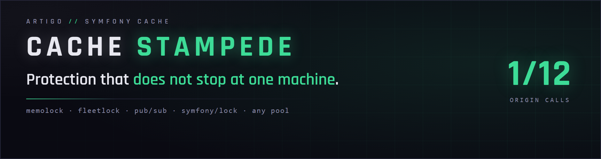
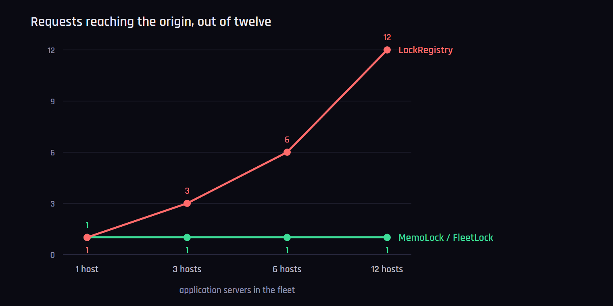
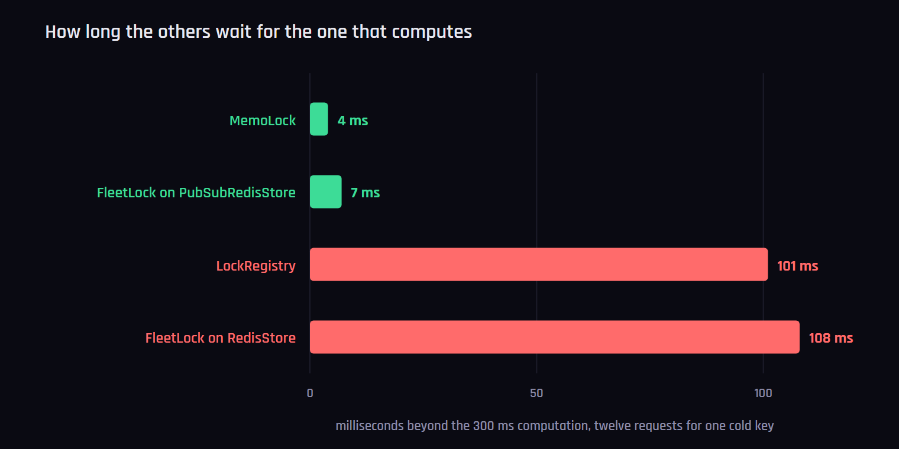
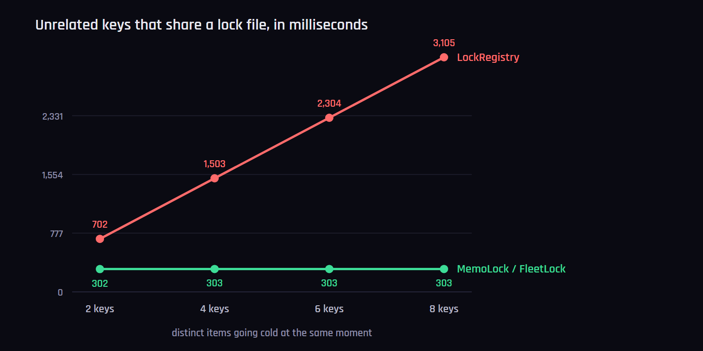

<p align="center">
	
</p>

**Stampede protection for `symfony/cache` that keeps a cold key to one origin call — on one server or on twelve.**

> **Its other half is [`artigo/versioned-cache`](https://github.com/artigo-dev/versioned-cache)**,
> a tag-aware Redis adapter whose invalidation costs four commands whether three
> items match or twenty thousand. This package keeps the herd off your origin;
> that one keeps the invalidation from being expensive in the first place.
> Neither depends on the other — see [Use them together](#use-them-together).

> [!NOTE]
> **Slides:** `MemoLock` is [stop 9, *The stampede*](https://artigo-dev.github.io/cache-talk/?lang=en#68051),
> and `StaleCache` [stop 13, *Nobody waits*](https://artigo-dev.github.io/cache-talk/?lang=en#68052),
> of [*Teaching Websites When to Forget*](https://artigo-dev.github.io/cache-talk/?lang=en),
> a talk for [rg-dev #69](https://www.meetup.com/rg-dev/events/317223103/)
> (25 November 2026): the road of a production PHP cache from no cache to
> versioned Redis in fifteen stops, in English and Polish, every chart a
> recorded run. Source and measurements: [artigo-dev/cache-talk](https://github.com/artigo-dev/cache-talk).
> Proposed for Symfony in [symfony/symfony#68051](https://github.com/symfony/symfony/issues/68051)
> and [#68052](https://github.com/symfony/symfony/issues/68052).

## What it is for

A cache key expires. The next request misses it and computes it — a report
that takes 400 ms, a query over a large table, a render. Every request that
arrives during those 400 ms misses it too, and without protection every one
of them runs the same computation. Symfony's answer is `LockRegistry`: the
first miss takes a `flock()` on a local file and computes, the others wait for
that file and then read what the first one stored. This package is about what
happens to that answer when the application runs on more than one server, and
when two keys that have nothing to do with each other land on the same lock
file.

**Example.** The key `report-monthly` expires at 12:00:00 on a fleet of twelve
application servers, and twelve requests arrive in the same moment, one per
server. The report takes the database 300 ms.

- **No protection:** twelve identical queries reach the database together,
  and each request waits 300 ms for its own.
- **`LockRegistry`:** one query per server. On one server that is one; on
  twelve servers it is twelve, because each server's lock file is its own and
  no other machine can see it. The user-facing wait is the same 300 ms; what
  scales with the fleet is the load at the origin.
- **This package, `MemoLock` or `FleetLock`:** one query across the fleet.
  The eleven requests that did not run it wait for the one that did, and are
  served what it stored: 4 ms over the 300 ms with `MemoLock`, which is woken
  by a message, 108 ms over it with `FleetLock`, whose waiters poll.

So the lock moves from a local file into a store every server shares, and a
cold key costs the origin one computation whatever the fleet size, at the
price of a few Redis commands per miss and a second connection for the
waiters' wake-up.

<p align="center">
	<a href="https://artigo-dev.github.io/cache-talk/?lang=en#68051"></a>
</p>
<p align="center"><em>From the talk: 24 requests on 12 servers for a report the
database takes 300 ms to build. LockRegistry makes 12 database calls, the last
answer at 403 ms; MemoLock makes 1, the last answer at 310 ms. The demos were
recorded with ovos/php-library, where these designs come from; its MemoLock is
the same lock.</em></p>

The second thing `LockRegistry` does is lock **a slot, not the key**: its lock
files are a fixed list — 25 on Symfony 6.4 and 7.4, 24 on 8.1, 27 on
8.2.0-BETA1 — and a key picks one by `abs(crc32($key)) % count($files)`. Two
unrelated items that land on the same file wait for each other, for a lock that
protects nothing they share: `product-42` waits behind `report-monthly` for the
whole 300 ms. The locks here are named after the key, so that never happens.
Both are measured in [Measured, not asserted](#measured-not-asserted).

## Installation

```bash
composer require artigo/cache-stampede
```

## Usage

```php
use Artigo\Cache\MemoLock;
use Symfony\Component\Cache\Adapter\RedisAdapter;

$pool = new RedisAdapter(RedisAdapter::createConnection('redis://127.0.0.1'));
$pool->setCallbackWrapper(MemoLock::fromDsn('redis://127.0.0.1'));
```

That is the whole integration. `setCallbackWrapper()` is a **public** method —
no subclassing, no fork, no patched core — on every Symfony pool that uses
Symfony's `ContractsTrait`: the adapters built on `AbstractAdapter` or
`AbstractTagAwareAdapter` (Redis, filesystem, APCu, PDO, Memcached …), and
`ChainAdapter`, `ProxyAdapter`, `TagAwareAdapter` and `PhpArrayAdapter`.
`ArrayAdapter`, `NullAdapter`, `TraceableAdapter` and `TraceableTagAwareAdapter`
do not have it. When the container has the profiler's cache collector
(`data_collector.cache`), `CacheCollectorPass` replaces each cache pool service
with a traceable adapter: set the wrapper on its `getPool()`, or as a
`setCallbackWrapper` call in the pool's service definition, which the pass keeps
on the inner pool.

[`examples/expensive-query.php`](examples/expensive-query.php) runs it — eight
processes released together on a key that has just expired:

```console
$ php examples/expensive-query.php
eight requests on a cold key, 400 ms to answer it

  waited   after   405 ms  ->  the report
  waited   after   405 ms  ->  the report
  waited   after   406 ms  ->  the report
  queried  after   404 ms  ->  the report
  ... four more

the query ran 1 time(s) for 8 requests
```

One query, eight answers, and the seven that waited are served **2 ms after**
the one that ran it.

The package holds four things: two **locks** for a cache pool's callback,
`MemoLock` and `FleetLock`, which differ in what the lock is made of; a
**store** for `symfony/lock`, `PubSubRedisStore`, whose waiters are woken by a
message; a **decorator**, `StaleCache`, which serves a value past its lifetime
while one process refreshes it; and, for `MemoLock` only, two calls for work
that is not a cache item, `once()` and `exclusively()`.

## Which one to use

Both locks fix the same two things: the lock is visible to the whole fleet,
and it is named after the key rather than drawn from a fixed list of files.
They differ in what the lock is made of. Measured with twelve requests for one
cold key that takes 300 ms to compute:

| | `MemoLock` | `FleetLock` | `LockRegistry` today |
|---|---|---|---|
| the lock is | a Redis key named after the cache key | a `symfony/lock` lock named after the cache key | a `flock()` on one of 24 local files (Symfony 8.1), picked by the key's `crc32` |
| it runs on | Redis 7.2+ or Valkey 8+, through `ext-redis` or Relay | any `symfony/lock` store: Redis, PostgreSQL, Doctrine DBAL, Memcached, Zookeeper … | each server's own files; not on Windows |
| calls to the origin, 12 requests on 12 servers | **1** | **1** | 12, one per server |
| the waiters' extra wait, over the 300 ms | **4 ms**, woken by a message† | 108 ms, a 100 ms poll\* | 101 ms, a 100 ms poll |
| what it costs | a few Redis commands per miss, and a second connection for the wake-up | one connection; the wake-up waits for the poll\* | one origin call per server, and unrelated keys on one file wait for each other |

\* except on the PostgreSQL stores, which block natively, and on
`PubSubRedisStore`, whose waiters are woken by a message: 7 ms.
† the subscriber is optional; without it `MemoLock` polls the lock key every
25 ms. Still one origin call, just a slower wake-up.

The 4 ms and the 108 ms come from the same run against the same Redis: what
separates them is only how a waiter finds out, a message or a poll.

**Reach for `MemoLock` when** Redis is already in the stack, 100 ms per waiter
matters to you, and a second connection is not a problem. It is also the only
one of the two that locks work that is not a cache item. **Reach for
`FleetLock` when** there is no Redis, when you would rather have one lock
abstraction across the application, or when you cannot spare the second
connection. Running it on Redis is an ordinary choice, not a fallback.

Full detail: [docs/locks.md](docs/locks.md#which-one-to-use)

## MemoLock: one request through, woken by a message

`MemoLock` keeps the lock in Redis, named after the key. The question is how
the requests that wait find out that the one computing is done. Say the holder
finishes computing `report-monthly` at 12:00:00.300: a waiter that looks every
100 ms, as `LockRegistry`'s do, notices by 12:00:00.400 at the latest, while a
`MemoLock` waiter is woken by a message at 12:00:00.301. The holder sends one
`PUBLISH` on a channel named after the key once it has saved the value, and
every waiter listens on that channel, so the waiters are served 4 ms over a
300 ms origin call rather than about 100 ms over it. The cost is a second
Redis connection, because a connection that listens for messages cannot serve
anything else; `fromDsn()` opens both. Pass your own connection instead, and
the second one comes from a factory you hand it; hand it none, and the waiters
poll the lock key every 25 ms: still one origin call, just a slower wake-up.

```php
// both connections from one DSN
$lock = MemoLock::fromDsn('redis://127.0.0.1');

// your own connection, and a factory for the second one, used only to SUBSCRIBE
$lock = new MemoLock($redis, static fn () => RedisAdapter::createConnection('redis://127.0.0.1'));

// your own connection only: waiters poll the lock key instead
$lock = new MemoLock($redis);
```

Set `lockTtlMs` to the longest the work should take: too low and the waiters
see the lock expire and compute in parallel, too high and a holder that dies
keeps everybody waiting.

```php
new MemoLock($redis, lockTtlMs: 30_000, waitTimeoutMs: 5_000);
```

<p align="center">
	<a href="https://artigo-dev.github.io/cache-talk/?lang=en#68051"></a>
</p>
<p align="center"><em>Woken by a message, not a timer: only the request that
took the lock can release it, and waiting needs a connection of its own.</em></p>

Full detail: [docs/locks.md](docs/locks.md#memolock-one-request-through-woken-by-a-message)

## FleetLock: the same lock on any `symfony/lock` store

`FleetLock` takes a `symfony/lock` `LockFactory` and knows nothing else, so it
locks on whatever store you already run: Redis, PostgreSQL, Doctrine DBAL,
Memcached, Zookeeper, anything the Lock component supports. The question is
what that gives up against a lock that speaks Redis directly. On the same
twelve requests for `report-monthly` it makes one origin call too, but the
Lock component has no way for a store to announce that a lock was released,
so on most stores the eleven waiters find out by retrying about every 100 ms.
What `FleetLock` gives up is only that wake-up time, and only on the stores
that cannot block:

| `FleetLock` on | a waiter is woken by | extra wait over a 300 ms origin call |
|---|---|---|
| Symfony's `RedisStore`, and most other stores | a 100 ms poll | 108 ms |
| the two PostgreSQL stores | the store, which blocks natively | not measured |
| [`PubSubRedisStore`](docs/locks.md#pubsubredisstore-the-wake-up-on-the-lock-components-side) | a Pub/Sub message | 7 ms |
| for comparison: `MemoLock` | a Pub/Sub message | 4 ms |

```php
use Artigo\Cache\FleetLock;
use Symfony\Component\Lock\LockFactory;
use Symfony\Component\Lock\Store\RedisStore;

$pool->setCallbackWrapper(new FleetLock(new LockFactory(new RedisStore($redis))));
```

On another store, only the store changes:

```php
use Artigo\Cache\Store\PubSubRedisStore;
use Symfony\Component\Lock\Store\DoctrineDbalPostgreSqlStore;

// no Redis: PostgreSQL, on the Doctrine DBAL connection you already have
$store = new DoctrineDbalPostgreSqlStore($connection);

// Redis, with waiters woken by a message; fromDsn() opens both connections
$store = PubSubRedisStore::fromDsn('redis://127.0.0.1');

$pool->setCallbackWrapper(new FleetLock(new LockFactory($store)));
```

Full detail: [docs/locks.md](docs/locks.md#fleetlock-the-same-lock-on-any-symfonylock-store)

## StaleCache: serving stale while it refreshes

A lock keeps a hot key from being computed twelve times when it expires, but
eleven requests still wait for that one computation. Does anyone have to wait
at all? With `StaleCache`, no: for a grace period past its lifetime, a value is
served at once while one process refreshes it. Twelve requests arrive at a hot
key as its lifetime ends, and the origin takes 300 ms:

| | requests that waited | longest wait |
|---|---:|---:|
| a lock alone (`expiring`) | 12 / 12 | 304 ms |
| Symfony's early expiration (`beta`), at its worst | 8 / 12 | 303 ms |
| **`StaleCache`** (`swr`) | **0 / 12** | **1 ms** |

Each makes one origin call; with `StaleCache` that call is the refresh, and it
runs after the response. The price is a value served up to `staleSeconds`
past its lifetime. An invalidated value is never served stale; the one
exception, which you opt into, is the next section. With `staleIfErrorSeconds`
the old value is also served when computing it again fails, instead of the
exception.

```php
use Artigo\Cache\Stale\RefreshQueue;
use Artigo\Cache\StaleCache;

$pool = new StaleCache($inner, staleSeconds: 60, staleIfErrorSeconds: 600, election: $lock);
$pool->setDeferrer($queue = new RefreshQueue());
$queue->flushAtShutdown();

$article = $pool->get('article-42', function (ItemInterface $item): Article {
    $item->expiresAfter(300);   // fresh for five minutes, served stale for one more

    return $this->load(42);
});
```

`$inner` is a pool with `$lock`, a `MemoLock`, as its callback wrapper, as in
[Usage](#usage); given as the election, `$lock` lets one process across the
fleet refresh. `RefreshQueue` runs the refresh after the response; without a
deferrer, the request that found the value stale waits for the refresh. In a
Symfony application the queue runs on `kernel.terminate` or
`console.terminate` through the shipped `TerminateSubscriber`, and between the
messages a Messenger worker handles through the `kernel.reset` tag:

```yaml
services:
    Artigo\Cache\Stale\RefreshQueue:
        tags: [{ name: kernel.reset, method: reset }]
    Artigo\Cache\Stale\TerminateSubscriber:
        arguments: ['@Artigo\Cache\Stale\RefreshQueue']
        tags: [kernel.event_subscriber]
    app.cache.articles:
        class: Artigo\Cache\StaleCache
        arguments: ['@cache.app', 60, 600]
        calls: [[setDeferrer, ['@Artigo\Cache\Stale\RefreshQueue']]]
```

<p align="center">
	<a href="https://artigo-dev.github.io/cache-talk/?lang=en#68052"></a>
</p>
<p align="center"><em>16 visitors around an expiry, a 300 ms build: the longest
wait is 302 ms plain and 1.2 ms with stale-while-revalidate, one rebuild after
the answer, and 7 visitors get the previous version.</em></p>

Full detail, with who refreshes, when, and what is served when the origin
fails: [docs/stale-cache.md](docs/stale-cache.md)

## Soft serving: after a tag invalidation, too

A tag invalidation makes a value a miss, so the next visitors wait for it to
be computed again. When a tag that 300 fragments carry falls, must every
visitor wait? With `soft: true`, over
[`artigo/versioned-cache`](https://github.com/artigo-dev/versioned-cache) with
`softGraceSeconds`, a value is served stale after its tag falls as well, and
refreshed once. Measured by versioned-cache's `benchmarks/soft.php`, with 300
fragments under one tag, twelve visitors reading 25 each, and a 20 ms origin:

| | visitors who waited | the 300 recomputations |
|---|---|---|
| hard invalidation | 12 of 12, about 560 ms each | during the responses |
| **soft invalidation** | **0 of 12** | after the responses, one per fragment |

The price is serving the old value for up to the grace period, so what must
never be served again is invalidated hard:

```php
$inner = new VersionedRedisTagAwareAdapter($redis, softGraceSeconds: 600);
$inner->setCallbackWrapper($lock);   // before it is handed over

$pool = new StaleCache($inner, staleSeconds: 60, election: $lock, soft: true);

$pool->invalidateTags(['menu']);               // served stale, refreshed once
$pool->invalidateTags(['price-42'], hard: true); // a miss, as ever
```

<p align="center">
	<a href="https://artigo-dev.github.io/cache-talk/?lang=en#68052"></a>
</p>
<p align="center"><em>The same 16 visitors around an edit: the longest wait is
303 ms after a plain invalidateTags() and 1.4 ms after a soft one.</em></p>

Full detail: [docs/stale-cache.md](docs/stale-cache.md#soft-serving-after-a-tag-invalidation-too)

## `once()`, `exclusively()`, `KeepAlive` and per-call overrides

`MemoLock` also locks work that is not a cache item, and lets a single call
borrow a different lock:

| | for | example |
|---|---|---|
| `once()` | a thing that is not a cache item: one caller makes it, the rest wait for the thing | four requests for a thumbnail that takes 400 ms to render: one render, four answers |
| `exclusively()` | a plain critical section, when the waiters want the lock rather than a result | eight workers holding a 200 ms section in turn: 11 ms lost to handovers, against 109 to 225 ms with `symfony/lock` |
| `KeepAlive` | work that outlasts its lock: each call moves the expiry out by a full TTL | an import that calls it after every row; a holder that dies is waited for one TTL at most |
| `with()`, `around()`, `unguarded()` | a different lock, or none, for one call; the pool's own lock is put back in a `finally` | a longer lock for a slow resolver, no lock for a cheap key |

### `once()`

When four requests ask for a thumbnail that does not exist yet, how many
render it, and what do the others wait for? With `once()`, one renders it, and
the other three wait for the thumbnail itself and finish within a millisecond
of it. `exists` is asked before any lock is taken, so a caller that arrives
after the work is done never touches Redis for one.

```php
$thumbnail = $lock->once(
    'thumbnail:'.$id,
    exists: static fn (): ?string => is_file($out) ? $out : null,
    make: function () use ($source, $out): string {
        $this->render($source, $out);

        return $out;
    },
);
```

### `exclusively()`

A plain critical section, for when the waiters want the lock rather than a
result. Unlike everything else here, it throws: an unreachable lock, or one
still held after ten attempts, is a `LockUnavailable`, since a caller who
asked that two workers never run something at once would rather hear that it
did not run.

```php
use Artigo\Cache\Exception\LockUnavailable;

try {
    $lock->exclusively('import:companies', function (): void {
        $this->importCompanies();
    });
} catch (LockUnavailable) {
    // the lock was unreachable or never let go: the import did not run
}
```

`symfony/lock` still releases on destruct, so a process that `exit()`s or hits
a fatal error mid-section hands its lock back at shutdown; here that case
costs the lock's remaining TTL.

### `KeepAlive`

An import that takes longer than its lock's TTL would have the lock run out
underneath it, and the next worker would start the same import beside it. The
closure holding the lock is handed a `KeepAlive`: call it as the work goes and
the expiry moves out by a full TTL each time, so the TTL can stay short. It
throws `LockUnavailable` if the lock has gone, expired and taken by somebody
else while the work ran.

```php
use Artigo\Cache\KeepAlive;

$lock->exclusively('import:companies', function (KeepAlive $keepAlive) use ($rows): void {
    foreach ($rows as $row) {
        $this->import($row);
        $keepAlive();   // the lock lasts a full TTL from here
    }
});
```

### Per-call overrides

Symfony's `get()` has nowhere to say that one key wants a longer lock, or
none. `with()` answers a copy of the lock with other settings, `around()` runs
one call with it and puts the pool's own lock back in a `finally`, and
`unguarded()` runs one call with no lock at all:

```php
// a copy with a longer lock; the lock it came from is not changed
$slow = $lock->with(lockTtlMs: 30_000);

// that copy for this one call, then the pool's own lock again
$value = $slow->around($pool, static fn () => $pool->get('external-api', $resolver));

// no lock at all, for a key not worth protecting
$value = MemoLock::unguarded($pool, static fn () => $pool->get('cheap', $resolver));
```

Full detail: [docs/once-and-exclusively.md](docs/once-and-exclusively.md), and
for the per-call overrides [docs/locks.md](docs/locks.md#per-call-overrides)

## Measured, not asserted

`benchmarks/stampede.php` spawns real processes, releases them on a shared
wall-clock barrier, and counts how many reach the origin. Measured on
2026-11-06 inside Docker Desktop (WSL2, Windows 11, 24 CPUs), the benchmark in
a `php:8.5-cli` container (PHP 8.5.12, phpredis 6.3.0) on the network of a
Redis 8.10.1 container, this package 2.0.0 against symfony/cache and
symfony/lock 8.1.11; every number is the middle of three runs (seven for two
colliding keys). On 8.2.0-BETA1 each row of the one-cold-key table came within
2 ms of these; the colliding keys vary too much between runs for that
comparison. Run again on 2.1.2 on 2026-11-22 (symfony/cache 8.1.7,
symfony/lock 8.1.6, and 8.2.0-BETA2): every number matched within 4 ms, except
six colliding keys under `LockRegistry`, which took 2.304 s in all three runs
instead of 1.904 s; the chart of unrelated keys below shows the new value.

Twelve requests for one cold key that takes 300 ms to compute:

| Setup | Calls to the origin | Extra wait over the 300 ms |
|---|---|---|
| no protection | 12 / 12 | 3 ms |
| `LockRegistry`, 1 app server | 1 / 12 | 101 ms |
| `LockRegistry`, 3 app servers | 3 / 12 | 101 ms |
| `LockRegistry`, 6 app servers | 6 / 12 | 101 ms |
| `LockRegistry`, 12 app servers | **12 / 12** | 1 ms |
| **`FleetLock`**, any fleet size | **1 / 12** | 108 ms |
| **`MemoLock`**, any fleet size | **1 / 12** | **4 ms** |

`LockRegistry` on twelve hosts looks *fast* only because nobody is waiting for
anybody.

```bash
docker compose up -d
php benchmarks/stampede.php workers=12 resolverMs=300 hosts=12 modes=nolock,memolock,fleetlock,fleetlock-pubsub,symfony-onehost,symfony-multihost
php benchmarks/stampede.php workers=12 resolverMs=300 hosts=3 modes=symfony-multihost
php benchmarks/stampede.php workers=12 resolverMs=300 hosts=6 modes=symfony-multihost
```



`LockRegistry` gives **exactly one origin call per app server** — three hosts,
three calls; twelve hosts, twelve — because its lock files are local and a
second machine cannot see them.



Woken by a message, the others wait 4 ms beyond the 300 ms computation with
`MemoLock` and 7 ms with `FleetLock` on `PubSubRedisStore`; woken by a 100 ms
poll, 101 ms with `LockRegistry` and 108 ms with `FleetLock` on `RedisStore`.



Unrelated keys that share a `LockRegistry` file wait for each other: eight
items at 300 ms each take **3.1 seconds between them instead of 0.3**, on a
single machine, with no fleet involved.

The table behind that chart, the run-to-run spread and why collisions come
early: [docs/measurements.md](docs/measurements.md)

## Notes worth knowing

Four things to know before production:

- **Neither lock will ever be the reason a request fails.** An unreachable
  Redis or lock store means the value is computed without protection, and the
  PSR-3 logger says so.
- **Locking works under the CLI and on Windows.** Setting the wrapper
  overrides Symfony's default of disabling locking under the CLI SAPI, and
  Symfony disables `LockRegistry` entirely on Windows; neither lock here does.
- **`$beta` is not read.** Probabilistic early expiration is not what these
  locks do. A forced recompute, `INF`, is honoured: it waits for the lock like
  any other waiter and then takes it.
- **Neither lock waits into `max_execution_time`.** A second before the limit
  the waiter stops and computes unprotected rather than be killed with nothing
  served; `exclusively()` throws `LockUnavailable` instead.

The rest, among them failed saves on Symfony 8.2 and why waiters take a read
lock: [docs/notes.md](docs/notes.md)

## Use them together

Invalidating a tag that matches twenty thousand items is one problem; twenty
thousand items going cold at once, on every server you have, is the next one.
[`artigo/versioned-cache`](https://github.com/artigo-dev/versioned-cache)
answers the first, this package answers the second.

```bash
composer require artigo/cache-stampede artigo/versioned-cache
```

```php
use Artigo\Cache\Adapter\VersionedRedisTagAwareAdapter;
use Artigo\Cache\MemoLock;
use Symfony\Component\Cache\Adapter\RedisAdapter;

$redis = RedisAdapter::createConnection('redis://127.0.0.1');

$pool = new VersionedRedisTagAwareAdapter($redis);
$pool->setCallbackWrapper(MemoLock::fromDsn('redis://127.0.0.1'));
```

Neither package requires the other. Where they meet:

- **`MemoLock` as the callback wrapper** of the versioned pool, as above. Tags
  declared inside the locked callback still reach the item and still
  invalidate; versioned-cache's `VersionedWithMemoLockTest` checks it.
- **`StaleCache` over the versioned pool**: a refresh is its forced `get()`,
  which its invalidation guard treats like a miss — a delete during the
  refresh refuses the write, a tag invalidation leaves it stale (see
  [On versioned-cache](docs/stale-cache.md#stalecache-serving-stale-while-it-refreshes)).
- **Soft serving**: see [Soft serving](#soft-serving-after-a-tag-invalidation-too)
  above.

A worked example of the two together, which runs, lives in the other repository:
[`examples/together.php`](https://github.com/artigo-dev/versioned-cache/blob/main/examples/together.php).
It warms a handful of tagged cards, invalidates the tag they share and reads
them back, printing how often the origin was reached at each step.

## Requirements

PHP 8.2+ · `symfony/cache` 6.4, 7.x or 8.x · and then either `ext-redis`/Relay
and **Redis 7.2+ or Valkey 8+** for `MemoLock`, or `symfony/lock` for `FleetLock`.
`StaleCache` needs nothing more; its `TerminateSubscriber` needs
`symfony/event-dispatcher`.

On Redis 8.4 and Valkey 9, `MemoLock` is four plain commands and no script. A
conditional form the server refuses gets a compare-and-set script, the same
round trip, and the lock learns this per command: Redis before 8.4 scripts both
the extension and the release, Valkey 8.1 only the release (`SET … IFEQ` is
there from 8.1, `DELIFEQ` from 9), Valkey 8.0 both
([how it works](docs/locks.md#memolock-one-request-through-woken-by-a-message)).
Every other command the lock sends — `SET NX PX`, `PTTL`, `EXISTS`, `PUBLISH`,
`SUBSCRIBE`, `UNSUBSCRIBE`, `EVAL`, `GET`, `DEL`, `PEXPIRE` — is years older than
Redis 7.2.

CI runs the suite on PHP 8.2 to 8.5 against Symfony 6.4, 7.4 and 8.1 and the
8.2 development branch, on real Redis 7.2, 8.4 and the current 8.x servers, on
a real Valkey 9, and through Relay. No Valkey 8 server is run: its paths, a
native `SET … IFEQ` with a scripted release, are covered by a connection that
refuses the native forms on the client side
(`tests/RedisCommandDialectTest.php`).

## Benchmarks

Every number above is something you can re-run rather than take on trust,
except the soft-serving table, measured by versioned-cache's
`benchmarks/soft.php`, and the slides' captions, recorded for the talk with
ovos/php-library. The stale-if-error table in
[docs/stale-cache.md](docs/stale-cache.md#stale-if-error) has no script here
either.

| script | question it answers |
|---|---|
| `benchmarks/stampede.php` | how many requests reach the origin when a key goes cold, and what does waiting cost? |
| `benchmarks/stampede.php keys=collide` | how long do unrelated keys that share a `LockRegistry` file wait for each other? |
| `benchmarks/stampede.php modes=fleetlock,fleetlock-exclusive,fleetlock-pubsub,fleetlock-pubsub-exclusive` | what does `FleetLock` lose when its waiters take the exclusive lock instead of the read lock? |
| `benchmarks/stampede.php modes=swr` | what does a request wait when a hot key turns stale, with a lock, with early expiration, and served stale? |
| `benchmarks/exclusively.php mode=symfony`, `mode=memolock` | what does handing a critical section over cost, `symfony/lock` against `exclusively()`? |
| `examples/expensive-query.php` | eight requests, one cold cache key |
| `examples/thumbnail.php` | four requests, one file that has to be generated |

`keys=collide` switches it from one shared key to distinct keys that share a
lock file, which is the last chart above and the second table in
[docs/measurements.md](docs/measurements.md#different-keys-that-happen-to-share-a-lock-file).
`hosts=N` models a fleet of N machines for `symfony-multihost`: each simulated
host gets its own `LockRegistry` file set — which is what a separate machine is
to `flock` — and the workers are dealt out to the hosts in turn. The other
modes ignore it.

`modes=` picks the locks to race: `nolock`, `memolock`, `fleetlock` on the
component's `RedisStore`, `fleetlock-pubsub` on `PubSubRedisStore`, the same
two with their waiters on the exclusive lock (`fleetlock-exclusive`,
`fleetlock-pubsub-exclusive`), and the two `symfony-` rows for `LockRegistry`
on one host and on a fleet.

## Licence

MIT. See [LICENSE](LICENSE).
