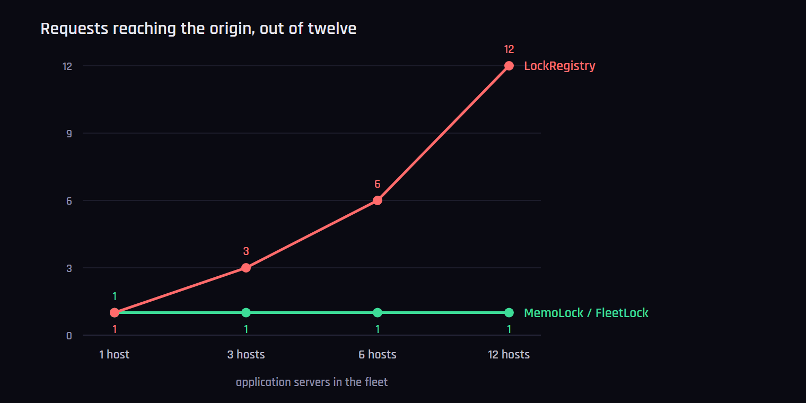
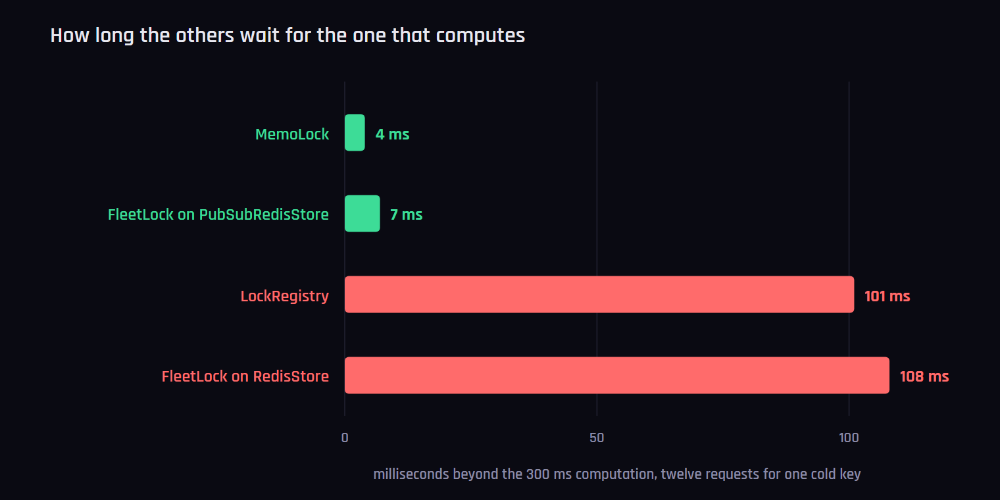
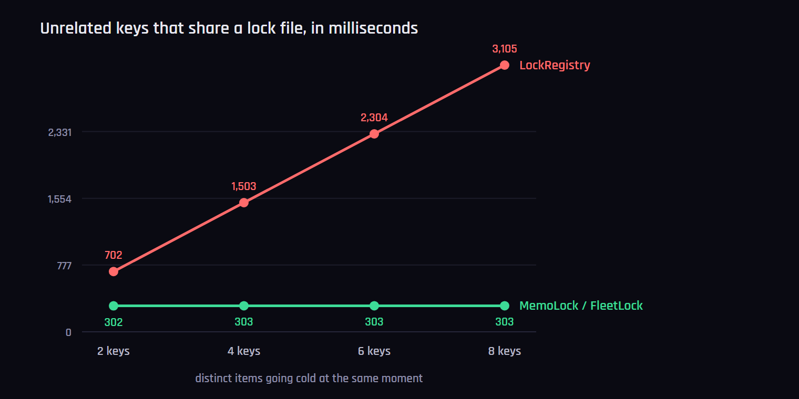

# Measured, not asserted

[← Back to the README](../README.md)

`benchmarks/stampede.php` spawns real processes, releases them on a shared
wall-clock barrier, and counts how many reach the origin. Measured on
2026-11-06 inside Docker Desktop (WSL2, Windows 11, 24 CPUs), the benchmark in
a `php:8.5-cli` container (PHP 8.5.12, phpredis 6.3.0) on the network of a
Redis 8.10.1 container, this package 2.0.0 against symfony/cache and
symfony/lock 8.1.11; every number is the middle of three runs (seven for two
colliding keys). On 8.2.0-BETA1 each row of the one-cold-key table came within
2 ms of these; the colliding keys vary too much between runs for that
comparison. Run again on 2.1.2 on 2026-11-22 (symfony/cache 8.1.7,
symfony/lock 8.1.6, and 8.2.0-BETA2): every number matched within 4 ms, except
those marked †.

## One cold key, twelve concurrent requests

| Setup | Origin calls | Overhead |
|---|---|---|
| no protection | 12 / 12 | 3 ms |
| `LockRegistry`, 1 app server | 1 / 12 | 101 ms |
| `LockRegistry`, 3 app servers | 3 / 12 | 101 ms |
| `LockRegistry`, 6 app servers | 6 / 12 | 101 ms |
| `LockRegistry`, 12 app servers | **12 / 12** | 1 ms |
| **`FleetLock`**, any fleet size | **1 / 12** | 108 ms |
| **`MemoLock`**, any fleet size | **1 / 12** | **4 ms** |

```bash
docker compose up -d
php benchmarks/stampede.php workers=12 resolverMs=300 hosts=12 modes=nolock,memolock,fleetlock,fleetlock-pubsub,symfony-onehost,symfony-multihost
php benchmarks/stampede.php workers=12 resolverMs=300 hosts=3 modes=symfony-multihost
php benchmarks/stampede.php workers=12 resolverMs=300 hosts=6 modes=symfony-multihost
```



`LockRegistry` gives **exactly one origin call per app server** — three hosts,
three calls; twelve hosts, twelve. Its lock files are local, so a second machine
cannot see them. Note the last row of its own block: twelve hosts looks *fast*
only because nobody is waiting for anybody.

How long the others wait for the one that computes, with the Lock component's
waiters woken by a message too ([`FleetLock` on `PubSubRedisStore`](locks.md#pubsubredisstore-the-wake-up-on-the-lock-components-side)):



## Different keys that happen to share a lock file

`LockRegistry` never locks the key. It locks one of a **fixed list of files** —
Symfony's own `Adapter/*.php` sources, opened for nothing but `flock` — picked
by `abs(crc32($key)) % count($files)`. The list is a static array —
`setFiles()` replaces it, and `compute()` drops a file whose wait timed out —
and its docblock says what its length means: *"The number of items in this
list controls the max number of concurrent processes."* So one machine can
compute **24 distinct keys at once** on Symfony 8.1, and the 25th waits for work
it has nothing to do with.

Distinct cold keys chosen to share a slot, 300 ms to compute each. All of them
genuinely need computing, so the lock saves nothing here and only lines them up.
`MemoLock` and `FleetLock` lock each key on its own, so nothing waits:

| unrelated keys | `LockRegistry` | `MemoLock` | `FleetLock` |
|---|---|---|---|
| 2 | 0.702 s | 0.302 s | 0.302 s |
| 4 | 1.503 s | 0.302 s | 0.303 s |
| 6 | 2.304 s† | 0.302 s | 0.303 s |
| 8 | 3.105 s | 0.303 s | 0.303 s |

The middle of three runs, seven for two keys. `LockRegistry`'s waiters find
the file free on their next 100 ms poll, so its times move from run to run:
eight keys took 2.606, 3.105 and 3.105 s†.

† From the run of 2026-11-22, where it moved by more than 20 %: six keys took
2.304 s in all three runs there, where the runs of 2026-11-06 took 1.81, 1.90
and 2.30 s.

```bash
for n in 2 4 6 8; do php benchmarks/stampede.php workers=$n resolverMs=300 keys=collide modes=symfony-onehost,memolock,fleetlock; done
```



A straight line: each further key adds about 400 ms, its own 300 ms and the
100 ms poll that finds the file free, so eight items at 300 ms each take **3.1
seconds between them instead of 0.3**, on a single machine, with no fleet
involved. Eight keys are
well under that ceiling, which is the point: collisions arrive long before the
list is exhausted, birthday-style, and these are simply chosen to make one
visible.

Both locks here take one lock per key — `FleetLock` names it
`$prefix.$item->getKey()`, `MemoLock` `memolock:lock:` and a hash of the key
in a cluster hash tag — so there is no slot table to land in, no ceiling on how
many distinct keys compute at once, and two unrelated keys are never each
other's problem.
`LockRegistry::setFiles()` will lengthen the list, but a longer list of local
files is still a list of local files.
